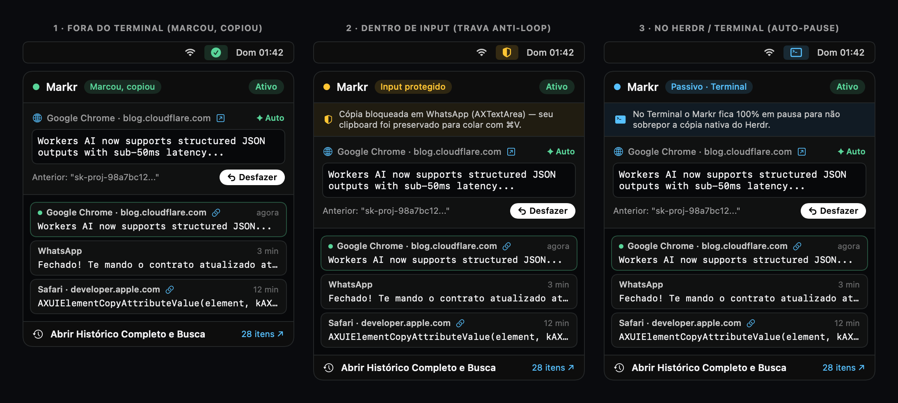
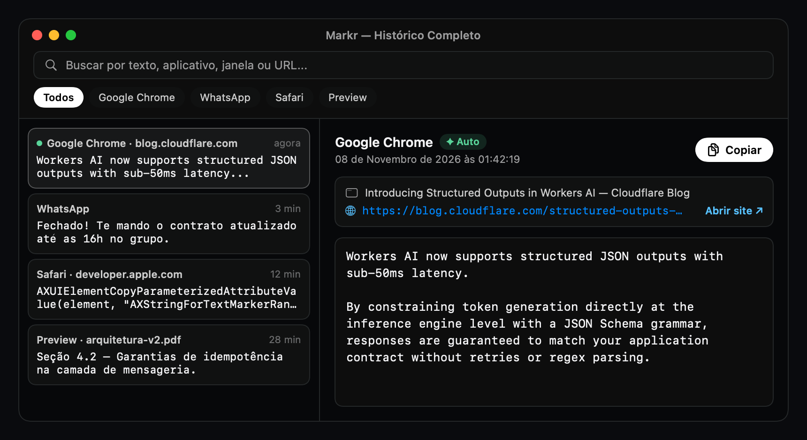

# Markr


> **Marcou, copiou.** Um utilitário nativo de barra de menus para macOS que leva o *Copy on Select* do terminal para o sistema inteiro — mas sabe a hora exata de **não** copiar quando você está editando um campo de texto ou dentro do próprio terminal.
>
> **Tipo:** `desktop` (macOS 13+) · **Stack:** Swift 6 + SwiftUI/AppKit + `AXUIElement` · **Licença:** [MIT](LICENSE)

---

## De onde veio a ideia

Quem passa o dia no terminal usando o **Herdr** (ou iTerm2, Ghostty, Warp) cria um reflexo muscular difícil de largar: você passa o mouse por cima de uma frase — ou dá um duplo clique num token — e pronto, já está copiado. Sem `Cmd + C`.

O problema aparece quando você sai do terminal. Você está lendo uma documentação no navegador ou uma conversa no WhatsApp, seleciona um trecho no automático, muda de janela, aperta `Cmd + V` e cola... um texto de meia hora atrás, porque esqueceu que fora do terminal o macOS exige o `Cmd + C` toda vez.

A ideia parecia simples: *"e se a gente fizesse um app que copiasse qualquer seleção de texto no Mac inteiro?"*

Mas bastou pensar dois segundos no uso real para esbarrar na armadilha que estraga quase toda extensão de *auto-copy*: **o loop do campo de texto**.

### O problema de selecionar para substituir

Imagine que você já copiou um link novo e quer colar por cima de um link antigo dentro de um campo de formulário, de uma barra de endereço ou da caixa de mensagem do WhatsApp. Qual é o seu gesto natural?
1. Você seleciona o texto antigo dentro do input para apagá-lo ou colar por cima.
2. Se o seu app de *Copy on Select* for ingênuo, no instante em que você seleciona o texto velho **ele copia o texto velho por cima do seu clipboard**.
3. Quando você aperta `Cmd + V`, você cola o próprio texto que estava tentando substituir.

E tem o segundo atrito: quando você volta para o terminal (onde o **Herdr** já faz *copy-on-select* nativo), ter dois sistemas interceptando a seleção ao mesmo tempo é receita para bagunça.

O **Markr** nasceu para resolver exatamente esses dois pontos.

---

## Como o Markr se comporta na prática



### 1. Fora do terminal: marcou na tela, está no clipboard (`✓`)
Em páginas web (Chrome, Safari, Arc, Brave), mensagens recebidas no WhatsApp/Slack, PDFs no Preview ou qualquer texto estático do sistema:
- Arrastou o mouse (`≥ 6pt`), deu **duplo/triplo clique** ou `Shift + Clique`? O Markr lê a seleção direto pela API de Acessibilidade (`AXUIElement`) sem disparar `Cmd + C` sintético e sem barulho de alerta do macOS.
- O ícone na Menu Bar pisca um `✓` rápido para confirmar que o texto já está na mão.

### 2. Dentro de campos editáveis: trava anti-loop (`🛡`)
Antes de tocar no seu clipboard, a `EditableGuard` inspeciona a árvore de Acessibilidade em **três pontos** (onde o clique começou no `mouseDown`, onde terminou no `mouseUp` e qual elemento está focado), subindo até 40 níveis do DOM/AX:
- Se a seleção aconteceu dentro de um `<input>`, `<textarea>`, `contenteditable="true"`, `AXTextField`, `AXTextArea` ou editor de código, **o Markr bloqueia a cópia automática**.
- O ícone na Menu Bar vira um escudo (`🛡`) e o seu clipboard fica 100% preservado para você colar com `Cmd + V` por cima do texto selecionado.
- E se você tiver selecionado um texto estático por acidente? O botão branco **`↩ Desfazer`** no topo do Popover restaura o item anterior do seu clipboard com um clique.

### 3. De volta ao Herdr / Terminal: pausa automática (`>_`)
Assim que o foco muda para o `Terminal.app` (onde roda o **Herdr**), `iTerm2`, `Ghostty`, `Warp`, `Kitty` ou `Alacritty`, o Markr entra em **Auto-Pause**:
- O ícone na Menu Bar muda para `>_` (`Passivo · Terminal`) e o monitor de mouse do Markr sai da frente, deixando o *copy-on-select* nativo do seu terminal trabalhar sozinho e sem sobreposição.

---

## Histórico com origem (App + URL do site)

No Popover da barra de menus ficam apenas os **últimos 5 itens copiados**, para manter a janela sempre enxuta e rápida. Clicando em **Abrir Histórico Completo e Busca**, abre-se o inspetor de duas colunas:



- **Sabe de onde você copiou (`ClipOrigin`):**
  - Se o trecho veio de um site ou blog no navegador, o Markr lê os atributos `AXURL` / `AXDocument` direto da `AXWebArea` (sem pedir permissões extras de Automação/AppleEvents) e guarda o **domínio + link clicável** (`Abrir site ↗`).
  - Se veio de um aplicativo desktop (WhatsApp, Preview, Finder), guarda o ícone nativo do app e o título da janela/documento.
- **Linha do tempo que não mente:** clicar num item antigo do histórico para copiá-lo de novo apenas coloca o texto no clipboard e acende o indicador verde (`●`) naquele card — **sem mudar a posição dele na lista nem adulterar a data/hora em que ele foi originalmente capturado**.

---

## Arquitetura por trás dos panos

```text
Gesto do Mouse (NSEvent Global Monitor passivo — nunca trava o cursor)
  │
  ├─► 1. TerminalAutoPause ──► É Terminal / Herdr? ──► [SIM] Pausa o gatilho (ícone >_)
  │
  ├─► 2. AXWarmup ───────────► Acorda árvore DOM/AX no Chrome / Electron (AXManualAccessibility)
  │
  ├─► 3. EditableGuard ──────► Sobe até 40 níveis AX (mouseDown + mouseUp + foco)
  │                            É <input>, <textarea>, contenteditable ou AXTextArea?
  │                            ──► [SIM] Bloqueia cópia e protege o clipboard (ícone 🛡)
  │
  └─► 4. AXExtractor ────────► Lê kAXSelectedTextAttribute / AXSelectedTextMarkerRange
                               Extrai App + Janela + URL (AXURL / AXDocument)
                               Salva no ClipHistory e atualiza NSPasteboard (ícone ✓)
```

---

## Como compilar e rodar

Requer **macOS 13+** e **Swift 5.9+** (Xcode Command Line Tools). Zero dependências externas.

```bash
git clone https://github.com/dspinillo/markr.git
cd markr
./scripts/build-app.sh
open ./build/Markr.app
```

1. Na primeira execução, clique em **Liberar** no topo do Popover (ou vá em `Ajustes do Sistema > Privacidade e Segurança > Acessibilidade`) e ative a chave do **Markr**.
2. O script `./scripts/build-app.sh` detecta automaticamente se você possui um certificado `Apple Development` no Keychain local e atualiza o bundle *in-place* — assim, mesmo que você recompile o código depois, o macOS mantém a permissão de Acessibilidade ativa sem pedir confirmação de novo.

---

## Mapa do repositório

```text
markr/
├── README.md        # história, funcionamento e como rodar
├── STATUS.md        # estado atual e histórico de sessões
├── HANDOFF.md       # guia rápido de retomada
├── ROADMAP.md       # fases entregues e backlog
├── CONTEXT.md       # vocabulário ubíquo do domínio
├── LESSONS.md       # aprendizados práticos de AXUIElement e TCC no macOS
├── decisions/       # ADRs (0001-stack.md, 0002-design.md)
├── docs/            # plano-visual.html, icones.html e assets/
├── Resources/       # AppIcon.icns
├── scripts/         # build-app.sh, generate-icon.swift e generate-screenshots.swift
└── Sources/Markr/   # código-fonte Swift / SwiftUI
```

## Licença

Distribuído sob a licença [MIT](LICENSE).
